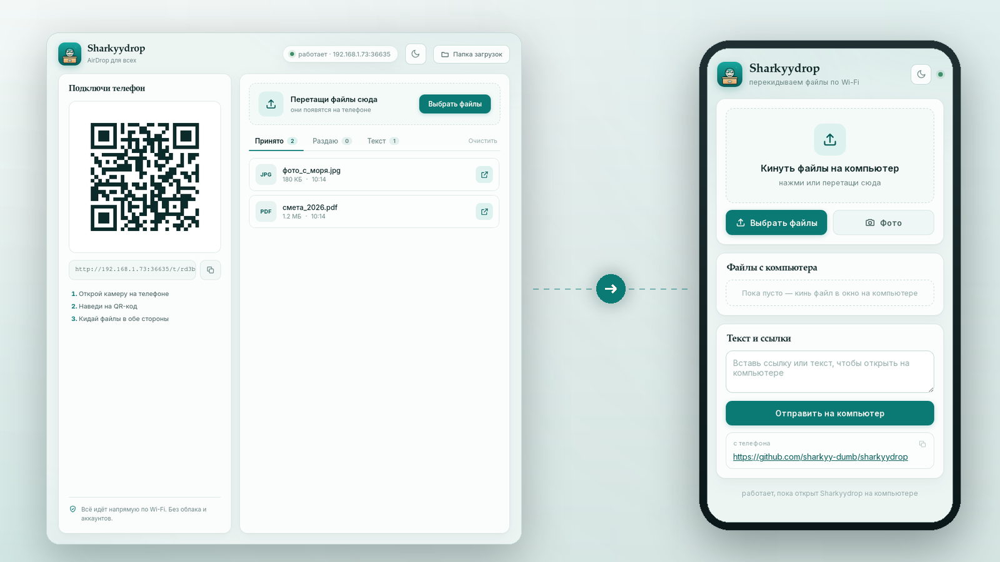
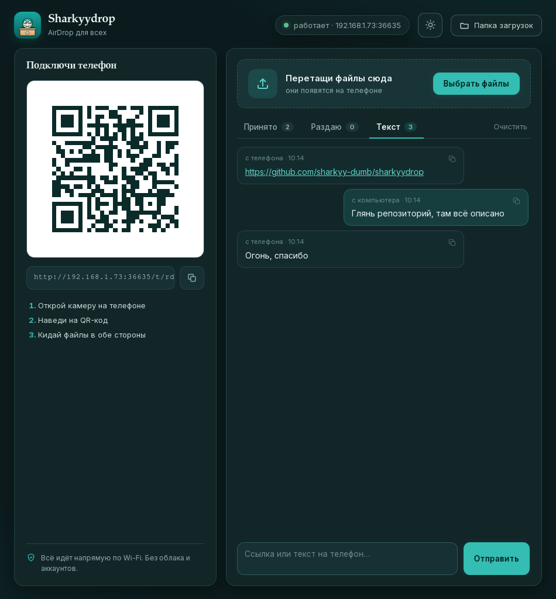
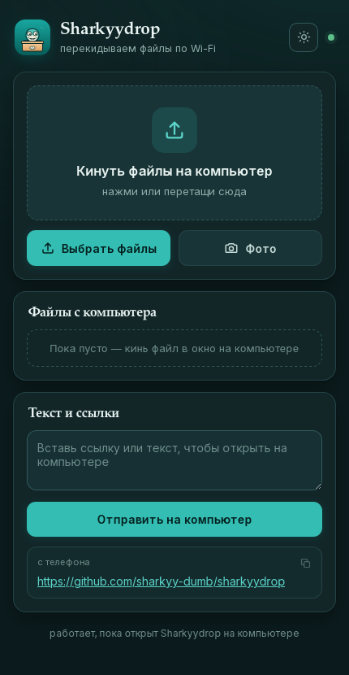

<p align="center">
  
</p>

<h1 align="center">Sharkyydrop</h1>

<p align="center"><b>AirDrop для всех.</b><br>
Перекидывай файлы и ссылки между компьютером и телефоном по QR-коду — напрямую по Wi-Fi,<br>
без облака, аккаунтов и установки приложений на телефон.</p>

<p align="center">
  
  
  
  
</p>



<details>
<summary><b>Тёмная тема</b></summary>
<br>
<p align="center">
  
  
</p>
</details>

## Зачем

Отправить фото с телефона на компьютер обычно больно: то мессенджер себе, то флешка, то облако с регистрацией. **Sharkyydrop** решает это за два шага: запустил на компьютере — навёл камеру телефона на QR — кидаешь файлы в обе стороны.

- никакой установки на телефон — открывается обычная веб-страница;
- никакого интернета и аккаунтов — всё идёт по твоему Wi-Fi;
- файлы не уходят на сервер, потому что сервера нет: он поднимается локально на компьютере и живёт, пока открыто приложение.

## Что умеет

- **Телефон → компьютер:** перетащил файлы или выбрал камеру — они уже в папке «Загрузки».
- **Компьютер → телефон:** перетащи файлы в окно и скачай их на телефоне.
- **Ссылки и текст** в обе стороны — удобно кинуть ссылку с телефона на компьютер.
- **Копирование в один клик** — ссылки и текст копируются прямо из истории.
- **Тёмная и светлая тема** — переключается кнопкой в шапке, выбор запоминается.
- Прогресс загрузки, история передач, открытие файла в один клик.
- QR-код и кнопка «скопировать ссылку».
- Защита: ссылка содержит одноразовый код, сервер слушает только локальную сеть.

## Как это работает

```
Телефон ──QR──▶ http://<ip>:<порт>/t/<код>
                        │
                        ▼
            Локальный сервер внутри «Sharkyydrop»
              (Rust + axum, только LAN)
                        │
          файлы ──▶ ~/Downloads
          текст ──▶ окно приложения
```

Приложение поднимает HTTP-сервер на случайном порту, генерирует код доступа и показывает QR. Телефон открывает мобильную страницу с того же сервера — устанавливать ничего не нужно.

## Приватность

- Нет телеметрии, нет внешних запросов, нет облака.
- Сервер доступен только в локальной сети и только пока приложение запущено.
- Ссылка содержит случайный код; без него страница и API отвечают `403`.
- Поверх Wi-Fi нет дополнительного шифрования — используй доверенную домашнюю сеть.

## Установка

### Готовые сборки

Скачай архив для своей системы со страницы [Releases](../../releases):

| Система | Файл |
| --- | --- |
| Windows | `Sharkyydrop_x.y.z_x64_portable.zip` |
| Linux | `Sharkyydrop_x.y.z_amd64.AppImage` / `Sharkyydrop_x.y.z_amd64.deb` |

Windows-сборка портативная: распакуй архив и запусти `Sharkyydrop.exe`. Нужен WebView2 — на Windows 10/11 он уже установлен.

### Собрать самому

Нужен стабильный [Rust](https://rustup.rs). На Linux ещё нужны библиотеки WebKitGTK:

```bash
# Arch
sudo pacman -S base-devel webkit2gtk-4.1 gtk3 librsvg openssl

# Debian / Ubuntu
sudo apt install build-essential libwebkit2gtk-4.1-dev libgtk-3-dev librsvg2-dev
```

Запуск:

```bash
git clone https://github.com/sharkyy-dumb/sharkyydrop.git
cd sharkyydrop
cargo run --manifest-path src-tauri/Cargo.toml
```

Сборка установщиков:

```bash
cargo install tauri-cli --version "^2"
cargo tauri build
```

Результат появится в `src-tauri/target/release/bundle/`.

## FAQ

**Телефон не открывает страницу.**
Телефон и компьютер должны быть в одной сети. Гостевая сеть и «изоляция клиентов» на роутере блокируют такие соединения. На Windows разреши приложению доступ к частным сетям в запросе фаервола.

**Куда приходят файлы?**
В системную папку «Загрузки». Кнопка «Папка загрузок» открывает её.

**Кнопка «Выбрать файлы» и перетаскивание — в чём разница?**
Перетаскивание работает с путями напрямую и лучше подходит для больших файлов. Выбор файлов читает их через окно и удобен для мелочи.

**Можно ли пользоваться в общественном Wi-Fi?**
Можно, но помни: в локальной сети нет шифрования. Для кафе и аэропортов лучше подождать домашней сети.

## Ограничения v0.1

- История передач живёт только до закрытия приложения.
- Нет шифрования поверх LAN.
- Только файлы, папки пока не поддерживаются.

## Лицензия

[MIT](LICENSE)
